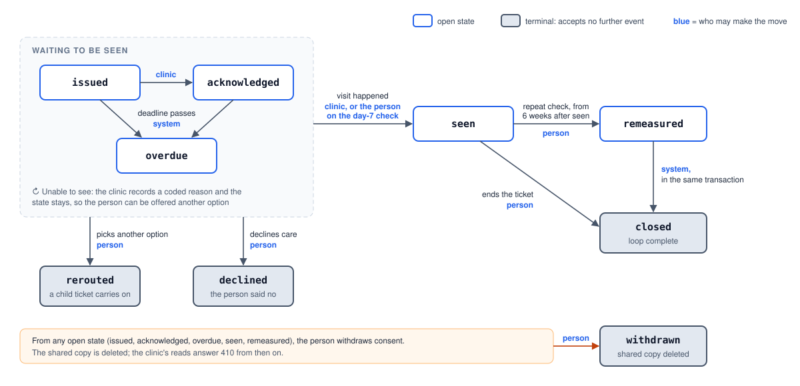

# Mawsool: technical documentation

Mawsool turns a positive mental-health screen in Abu Dhabi into a **referral ticket**: a time-bound hand-off to the least
intensive suitable care, owned until the person is seen, with every missed hand-off visible on a dashboard. This
document describes the prototype as built. What it takes for granted is in [`assumptions.md`](assumptions.md); what it
does not do, or does not do yet, is in [`limitations.md`](limitations.md).

## 1. What the prototype does

| Who                 | What they get                                                                                                                                                                                                   |
| ------------------- | --------------------------------------------------------------------------------------------------------------------------------------------------------------------------------------------------------------- |
| A person            | A short check-in (WHO-5, then PHQ-9 and GAD-7), a plain result that says what it does and does not mean, matched care options, a consent screen per item of data, a ticket with a deadline, a day-7 "did you get seen?" check, a repeat check after six weeks, and a crisis screen that needs no network |
| A clinic            | A queue of tickets addressed to it, ordered by deadline; the detail shows only what the person agreed to share; Acknowledge, Seen and Unable to see; a FHIR R4 export; a no-login link for a clinic with no portal |
| A programme lead    | A funnel from positive screen to seen, timeliness by tier, crisis-response completion, symptom change, an equity view, an adverse-events log, with every small number hidden                                         |
| A front door (TAMM, a health centre, a school) | A signed way to hand a positive screen over, which becomes an invite the person claims, never a ticket made for them                                                                 |
| A crisis line (mock) | A console that receives a short note the person chose to send from the crisis screen, and a "contact made" button                                                                                             |

Source: the apps' screens under `apps/person/app/[locale]`, `apps/clinician/app/[locale]` and `apps/ops/app/[locale]`, and
the route list in `apps/api/test/access.test.ts`, at commit `ce088c9`.

## 2. Architecture


Source: a summary of the code at `a40b68d` (`apps/*`, `packages/*`), drawn by hand; it is a description of verified code,
not a proposed design.

Design choices that shape everything else:

- **The device does the sensitive work.** Scoring, the crisis trigger and matching run on the phone, so answers,
  preferences and insurance class never leave it during matching. The server sees only what the person sends with a
  ticket, element by element.
- **One API, many thin clients.** The three web apps and the connectors hold no business logic of their own beyond what
  must run on the phone; tickets, consent, sharing and every state change go through the API.
- **The crisis path depends on nothing.** It is decided on the device by a package that imports no network code, and
  the call goes from the phone to the line. Every network entry point can fail and the crisis screen still appears.
- **A ticket's state is derived from its events.** Events are append-only; the current state is a cache written in the
  same transaction, and a unique `(ticket, sequence)` constraint settles every race.

## 3. Repository layout

| Path                     | Contents                                                                                                   |
| ------------------------ | ---------------------------------------------------------------------------------------------------------- |
| `apps/api`               | The Ticket API, staff sign-in, the deadline sweep, metrics, the seed                                       |
| `apps/person`            | The person's app: a static-export PWA (check-in, results, matching, consent, ticket, crisis, settings)     |
| `apps/clinician`         | The clinic's queue, ticket detail, FHIR export, no-login clinic link page                                  |
| `apps/ops`               | The ops dashboard; the admin panel (demo clock, reset, crisis-number dates); the mock crisis-line console  |
| `packages/types`         | Zod schemas and TypeScript types for every entity and contract                                             |
| `packages/instruments`   | WHO-5, PHQ-9, GAD-7 and C-SSRS screener items, scoring and the crisis evaluation; wording sources in `SOURCES.md` |
| `packages/rules`         | The matcher, deadlines and `config.ts` (thresholds, windows, crisis numbers, the sample insurance table)   |
| `packages/consent`       | The list of shareable elements and the redaction used on the phone and again on the server                 |
| `packages/summary`       | The only code allowed to call an LLM: the referral-summary prompt, template fallback, Anthropic and Microsoft Foundry clients      |
| `packages/fhir`          | The FHIR R4 export and the official R4 JSON schema it is tested against                                    |
| `packages/ui`            | Design tokens, fonts, right-to-left helpers, shared components, platform adapters (storage, notifications, dialler) |
| `infra/`                 | `docker-compose.yml` for Postgres                                                                          |
| `docs/`                  | This document and the topic notes listed in [`docs/README.md`](README.md)                                  |

Source: the repository tree at `ce088c9`.

## 4. The main flows


Source: drawn by hand from sections 4.1 to 4.6 below and the person app's screens under `apps/person/app/[locale]` at
`a40b68d`; numbers are the order a typical journey takes.

**What this tells us**
- Steps 1 to 4 run on the phone, and the answers to each question never leave it. At step 5 the server receives only
  the items the person ticked, and before that only if they ask the assistant for a draft (or a crisis event, without
  answers).
- Once issued, the ticket is watched from three sides: the clinic acts on it, from day 7 (or the deadline, if sooner) the
  ticket screen asks the person whether they were seen, and the system marks it overdue when the deadline passes.
- The crisis screen sits outside the main line: it can interrupt any check-in, and the matching and ticket screens stay
  closed while it is open.

### 4.1 Check-in and result

WHO-5 opens (five items, scored 0–100). A score of 50 or less offers PHQ-9 and GAD-7, and a person can choose them
directly. Totals and bands follow the published cut-offs (PHQ-9 0–4, 5–9, 10–14, 15–19, 20–27; GAD-7 0–4, 5–9, 10–14,
15–21). The result screen gives the band, a plain meaning and a "this is a screen, not a diagnosis" line; a test fails if
any person-facing message uses a diagnostic label. Check-ins are kept on the phone, encrypted, and a trajectory shows
reliable change between check-ins (PHQ-9 6 points, GAD-7 4 points). A reliable deterioration is flagged on the result;
the options screen always matches on the latest scores, so a higher score is offered a more intensive level of care.

### 4.2 Crisis path

PHQ-9 item 9 answered above 0 stops the questionnaire at once and opens a full-screen crisis page with 800-SAKINA, 999
and 998 as tap-to-call buttons and as text. Nothing dismisses it by itself; only "I'm with someone safe" or "I'm safe
right now" releases it, and until then every matching and ticket screen redirects to it. The page and its numbers are
precached, so it opens offline. A crisis event (trigger, which number was tapped, whether contact was confirmed, never the
answers) is queued on the phone and sent when it can be.

Two optional extras sit beside it, never on it: a note to the crisis line the person can choose to send (with a stop
control that deletes it), and a gentle next-day check. Each has its own bounded wait and its own failure message; the
crisis screen never waits on either. `pnpm gate:a` proves the trigger fires with every network entry point stubbed to fail.


Source: drawn by hand from `packages/instruments/src/crisis.ts`, `apps/person/lib/crisis.ts`, `apps/person/lib/routes.ts`
(`GUARDED_ROUTES`) and [`crisis-line-handoff.md`](crisis-line-handoff.md) at `a40b68d`.

**What this tells us**
- Everything the person needs in a crisis is in the top layer, on the phone; none of it waits for a server.
- The two lower layers can fail without touching the top one: a crisis event that cannot be sent waits on the phone and
  goes later, and a note that cannot be sent says so on the screen while the numbers stay where they are. Releasing
  the screen waits at most half a second for the next-day check to be scheduled.

### 4.3 Matching

`match()` in `packages/rules` is a pure function over the screen result, preferences, insurance class, region and the
service directory. It follows a stepped-care table (most intensive matching row wins) and shows one to three option
cards with "why this fits" reasons and eligibility: the row's recommended options first, in the table's order (best fit
first), then, under "Show other options", the remaining levels of care, least intensive first. Every stepped-care
threshold, hand-off window and sample table lives in `packages/rules/src/config.ts`; the questionnaire band cut-offs live
with the scoring in `packages/instruments`.

| Screen result              | Offered first                       | Hand-off window | Re-check |
| -------------------------- | ----------------------------------- | --------------- | -------- |
| PHQ-9 20–27 or GAD-7 15–21 | Specialist; GP or tele as a bridge   | 14 days         | 6 weeks  |
| PHQ-9 15–19                | Specialist or GP                    | 14 days         | 6 weeks  |
| PHQ-9 10–14 or GAD-7 10–14 | GP or tele                          | 7 days          | 6 weeks  |
| PHQ-9 5–9 or GAD-7 5–9     | Guided self-help or community        | 14 days         | 4 weeks  |
| Below 5                    | Self-help                           | none            | 4 weeks  |

Source: `STEP_ROWS` in `packages/rules/src/config.ts` at `ce088c9`. These are proposed defaults from the product spec,
not clinically signed off (see [`assumptions.md`](assumptions.md)).

### 4.4 Consent and the ticket

The consent screen lists each element (scores, trajectory, free-text note, self-reported conditions, preferences) for the
chosen clinic. Only the ticket itself is required; everything else starts off. The person can draft a short note, by
template or, if they tick it, with the summary assistant, then edit and approve it. On Send, the phone redacts to what was
ticked; the API redacts again, writes one consent row per element, encrypts the shared bundle, and issues the ticket with a
six-character code, a QR payload and a deadline. A retried send reuses its request id, so it cannot make two tickets.

### 4.5 The clinic side

The clinician app lists its own facility's tickets, earliest deadline first. Opening one shows only the consented
elements; anything else reads "Not shared by the person". Every read of the shared data checks that consent is still live,
redacts again and writes an audit row the person can see. The clinic moves the ticket with Acknowledge, Seen or Unable to
see (with a coded reason). The FHIR export builds an R4 Bundle (ServiceRequest, QuestionnaireResponse, Condition) from the
consented elements only, is validated against the official R4 schema in tests, and is labelled "Malaffi-ready export — not
sent". A clinic without portal access gets a one-time link instead; its secret sits in the address fragment, is never sent
in a URL, and is removed from the browser history once read.

### 4.6 Closing the loop

A job runs every minute and marks tickets past their deadline `overdue`. On day 7 (or at the deadline if sooner) the
person app asks "Did you get seen?": Yes marks the ticket seen, Not yet asks why and offers a reroute, No declines it.
A reroute never edits the old ticket; it closes it as rerouted and issues a linked child ticket, so the dashboard counts
the journey once. Six weeks after `seen` the person can take a repeat PHQ-9 and GAD-7 and, if they choose, send the
totals; this moves the ticket to `remeasured` and then `closed`.

### 4.7 Front doors

`POST /inbound/screens` takes a positive screen from TAMM, a health centre or a school, signed with that source's own
HMAC-SHA256 key, a timestamp within 300 seconds and a one-time nonce. It creates an invite with a claim code, never a
ticket; nothing is shared until the person claims it and consents. The demo includes a labelled mock TAMM result page.


Source: drawn by hand from [`inbound-screens.md`](inbound-screens.md) and `apps/api/src/inbound/` at `a40b68d`.

**What this tells us**
- A front door can start a journey but cannot make a referral: it gets back a code, and only the person turns it into a ticket.
- A forged, late or replayed request leaves nothing behind. A missing or wrong signature, a time outside the window and
  an unknown source all get the same 401; a reused nonce is a 401 `replayed`.

### 4.8 The dashboard

Funnel, timeliness, crisis completion, symptom change and equity (age band, gender, language, region, all opt-in) are
computed server-side. Every published number under 10 is hidden, and cells that add up to a total are hidden further
until no small number can be worked out from one response's figures. Every tile has an info panel with its definition,
numerator and denominator (generated into [`metric-definitions.md`](metric-definitions.md)). The seed plants an equity
gap the dashboard finds: Urdu-language tickets close the loop about 20 points below the overall rate.

## 5. Ticket lifecycle



| State          | Entered when                                                        | Can move to                                                              |
| -------------- | ------------------------------------------------------------------- | ------------------------------------------------------------------------ |
| `issued`       | The person sends a ticket with consent                              | `acknowledged`, `overdue`, `seen`, `rerouted`, `declined`, `withdrawn`   |
| `acknowledged` | The clinic acknowledges (portal or link)                            | `overdue`, `seen`, `rerouted`, `declined`, `withdrawn`                   |
| `overdue`      | The deadline passed without `seen`                                  | `seen` (late), `rerouted`, `declined`, `withdrawn`                       |
| `seen`         | The clinic marks it seen, or the person says Yes on the day-7 check | `remeasured`, `closed`, `withdrawn`                                      |
| `remeasured`   | The person finished the repeat check                                | `closed`, `withdrawn`                                                    |
| `rerouted`     | The person picked a new option; a child ticket carries on           | terminal                                                                 |
| `closed`       | The loop is complete, or the person ended it                        | terminal                                                                 |
| `declined`     | The person declined care                                            | terminal                                                                 |
| `withdrawn`    | The person withdrew consent; the shared copy is deleted             | terminal                                                                 |

Source: `RULES` in `apps/api/src/tickets/transitions.ts` at `ce088c9`, which also records who may fire each move. It
widens the product spec's table so a person can decline, reroute or be seen from any open waiting state, and withdraw
from any state that is not terminal. The diagram is drawn by hand from the same `RULES` at `a40b68d`.

**What this tells us**
- Every move has a named owner, and anyone else who tries it gets a 403; the system's only moves are marking a ticket
  overdue and closing it after a repeat check.
- A waiting ticket leaves the waiting states only as seen, rerouted (a child ticket carries on), declined or withdrawn;
  until then it stays in the clinic's queue. Once the sweep marks it overdue (within a minute of the deadline), it counts
  in the dashboard's "Overdue now" list, which appears only when 10 or more tickets are overdue.

An illegal move is a 409; a move the caller may not make is a 403. Only the clinic acknowledges, only the system marks a
ticket overdue, and only the system closes a ticket after a repeat check. Crisis is not a ticket state: it is a separate
event that blocks matching, so a crisis never sits in a queue.

## 6. Privacy and data protection


Source: drawn by hand from `packages/consent`, `apps/api/src/crypto.ts` and the bundle and consent routes under
`apps/api/src` at `a40b68d`, as described in sections 4.4, 4.5 and below.

**What this tells us**
- An item the person did not tick is dropped three times over: on the phone, on arrival, and again at every clinic read.
- Stopping is not a flag the clinic is trusted to respect: the shared copy itself is rewritten or deleted, so the server
  has nothing left to give. A FHIR export the clinic already downloaded stays with the clinic.

- **No account, no name.** The phone makes a random id and secret on first run; the server keeps only the secret's hash.
  No name, email, Emirates ID or phone number is needed.
- **On the phone:** check-ins and choices are kept in an IndexedDB store encrypted with AES-GCM under a key the page cannot
  export. One deliberate exception: while a crisis is open, the tab keeps a small plain-text mark (trigger, event id,
  time; no answer or score) so a failing store can never lose the block. Settings says so in both languages.
- **On the server:** shared bundles, approved summaries and logged drafts are AES-256-GCM ciphertext bound to their row.
  The API refuses to start without a 32-byte key. No column takes its time from the database clock.
- **Consent is per element and revocable.** Revoking an element rewrites the bundle without it; revoking the ticket
  empties the bundle and withdraws a ticket that is still open, after which the clinic's reads answer 410. "Delete
  everything" removes every shared copy, note, phone number, invite, link and opt-in the server holds for the person; the
  tickets stay as pseudonymous timings (a random person id, the service, the level of care and the language), with no
  shared content, so the dashboard keeps its counts. A test fails
  if any table linked to a person has no reviewed erase path.
- **No employer or insurer path.** There is no such role. A test walks the live route registry, fails on any route
  nobody reviewed, and refuses every wrong caller on every person and clinician route.
- **Equity data is opt-in and coarse,** and switches itself off after 180 days without the phone reaching the server.
- **Phone numbers** are asked for only for optional reminders or an optional crisis-line callback, kept encrypted in their
  own table, and never logged. Reminder messages carry no clinical words; a test checks both languages.
- **The request log** records the method and the route pattern only: no URL, id, query, host or client address. The
  mock messaging log does hold the staff sign-in and clinic links it would have sent, on purpose, since that is how the
  demo delivers them; it never holds a phone number or a reminder's text.
- **Anonymous mode** makes no network request at all; its check-ins live in a per-session encrypted database deleted on
  leaving.

## 7. Where AI is used, and where it is not

- **No AI in scoring, triage or the crisis path.** Scores come from published instruments, routing from the rules table.
- **One optional use:** drafting the short referral note. It is off unless the server enables it
  (`SUMMARY_LLM_ENABLED`, default off) and the person ticks "Use AI to help write my note". The prompt sees only the
  elements the person consented to, forbids diagnosis, advice and risk scoring, and is capped at 120 words. The person edits
  and approves the text; only approved text is shared. Without the flag, or on any failure, a fill-in template is used.
- **In the demo:** the video, the hosted demo and a live demo show the AI draft at step 6
  ([how](running-the-demo.md#the-referral-summary-assistant-at-step-6)); `pnpm gate:c` checks the template path.
- **Enforced in code:** a lint rule and a package-manifest check fail when anything outside `packages/summary` imports an
  LLM SDK, and `packages/summary/test/boundary.test.ts` proves the rule with cases that must fail.
- The client is Anthropic's SDK or its Foundry client, chosen by `SUMMARY_PROVIDER` (`anthropic` or `foundry`; there is no
  default, and the API refuses to start with the flag on and no choice). Foundry takes `SUMMARY_FOUNDRY_API_KEY` and
  `SUMMARY_FOUNDRY_RESOURCE` (the resource name only, as the Foundry portal shows it). The API reads these names and never
  the SDK's `ANTHROPIC_FOUNDRY_*`, so a value exported in the shell cannot stand in for them. The default model is
  `claude-sonnet-5-5` (`SUMMARY_MODEL` changes it); on Foundry it is the deployment name.

## 8. Security

- **Staff sign-in** is a one-use link, valid 15 minutes, written to the API log rather than emailed (a mock); only its
  hash is stored. Roles are `clinician` (bound to one facility), `ops`, `admin` and `crisis_line`.
- **Every route declares who may call it**, and the API refuses to start if one does not. A clinician route under
  `/tickets` must also be facility-scoped: a clinician asking for another facility's ticket gets a 404
  (`pnpm gate:facility-scope`).
- **A person sees only their own rows;** someone else's ticket is a 404, the same as one that does not exist.
- **Every API response** carries `Cache-Control: no-store`, a `default-src 'none'` content security policy,
  `X-Content-Type-Options: nosniff` and `Referrer-Policy: no-referrer`. The staff apps send a strict page policy (scripts
  and connections to themselves and the API only, no framing, no `eval`) and keep their session in `sessionStorage`.
- **Inbound screens** are signed per source, time-boxed and single-use, and every failure is the same 401.

## 9. API

50 routes: 48 product routes plus 2 demo routes that exist only when `DEMO_MODE` is on. `/docs` serves the OpenAPI
document generated from the routes' Zod schemas.

| Caller                    | Routes                                                                                                         |
| ------------------------- | -------------------------------------------------------------------------------------------------------------- |
| Open                      | health, register a phone, staff sign-in (2), service directory, OpenAPI, demo clock reading                    |
| Person (own data only)    | tickets and their events, reroute, repeat check, consents, crisis events, crisis-line notes, opt-ins, reminder phone, summary draft, claim an invite, delete everything |
| Clinician (own facility)  | queue, ticket detail, move a ticket, shared bundle, FHIR export                                                |
| Ops                       | aggregates only: funnel, timeliness, crisis, equity, symptom change; adverse events (ops or admin)             |
| Admin                     | clinic portal access; demo clock and reset (demo only)                                                         |
| Crisis line (mock)        | list notes, read a note, mark contact made                                                                     |
| Front door (signed)       | send a positive screen                                                                                          |
| Clinic link (one ticket)  | open, act                                                                                                       |

Source: the `REVIEWED` table (48 entries) and the demo-route list (2 entries) in `apps/api/test/access.test.ts` at
`ce088c9`; that test fails if the live route registry and this list ever differ.

## 10. Time, and the demo clock

Care time (deadlines, the sweep, the day-7 check, metrics periods) and security time (sessions, link expiry, signature
windows) are separate clocks. Normally both are the wall clock. With `DEMO_MODE=true`, an admin can move care time
forward by 7 days, 3 weeks or 6 weeks, or reset everything to the seed; staff stay signed in and signatures stay valid.
Details: [`two-clocks.md`](two-clocks.md) and [`running-the-demo.md`](running-the-demo.md).

## 11. Testing and verification

| Check                     | What it proves                                                                                                       |
| ------------------------- | -------------------------------------------------------------------------------------------------------------------- |
| `pnpm verify`             | Script tests, lint, typecheck, Vitest (100% coverage thresholds on the instruments, rules, consent, FHIR and summary packages), builds, and a start-up smoke test of all four apps. CI runs exactly this |
| `pnpm gate:a`             | The crisis trigger fires with every network entry point stubbed to fail                                              |
| `pnpm gate:facility-scope`| A clinician cannot read another facility's ticket                                                                    |
| `pnpm gate:seed`          | The seed's content, its determinism and the planted Urdu gap                                                         |
| `pnpm gate:b`             | Every sentence of the closed-loop phase's exit acceptance has its named tests present and passed (consent, revoke, no employer route) |
| `pnpm gate:postgres`      | On real Postgres: concurrent sweeps, races on links, hand-offs and nonces, migrations, Delete everything, the demo reset |
| `pnpm gate:phase2/3/4`    | The person, closed-loop and receiving-side flows in a real Chromium, in Arabic and English, against the real API      |
| `pnpm gate:c`             | The whole demo script end to end in Arabic and English, failing on any browser console error except two named, deliberately provoked 404s |

Source: the command table in `CLAUDE.md` and `package.json` at `ce088c9`.

The browser gates hold 149 named acceptance tests across their four registries (30 + 65 + 34 + 20, each run in both
languages) and include pixel snapshots of key screens at a 390×844 phone size. On commit `ce088c9`, all ten local gates
passed on 2026-11-13, and the four browser gates also passed in the Linux container CI uses. On GitHub that commit's
`verify` job stopped early when one test timed out; the timeout was fixed in `bc1c505`, and CI has since passed in full,
most recently on `3d73438` (see [`limitations.md`](limitations.md), item 22).

Source: registry sizes from `apps/person/e2e/acceptance*.json`; local results from the gate log of 2026-11-13
21:51–22:45 PHT recorded in the build's final report; GitHub results from Actions runs 43542562936 (2026-11-14 01:46 UTC /
09:46 PHT, the timeout) and 43808236336 (`3d73438`, 2026-11-16 05:07 UTC / 13:07 PHT, passed).

**What this tells us**
- The central guarantees (the crisis path without a network, facility scoping, consent and revoke, no employer route,
  the full demo in both languages) are each backed by a named automated check, not by review alone.
- These are checks of the cases the team wrote down. They are not a security audit, a load test or a clinical safety review.

## 12. Running it

Needs Node 24.11.1 (`.nvmrc`), pnpm 12.6.0 (pinned in `package.json`) and Docker.

```bash
# terminal 1
nvm install                     # Node from .nvmrc
npm install -g pnpm@12.6.0      # the version pinned in package.json
pnpm install
cp .env.example .env            # local values only; uncomment DEMO_MODE=true for the demo
pnpm dev                        # Postgres, migrations, API :4000, person :3000, clinician :3001, ops :3002 (keeps running)

# terminal 2, once the apps answer
pnpm db:seed                    # demo staff, 24 sample services, 500 simulated tickets over 90 days
```

For the demo walkthrough, `DEMO_MODE=true` is required: after seeding, sign in to the ops app as admin and press
**Reset the demo**. Reset moves the seeded 90 days so they end today and creates the first persona's invite; without it
the dashboard's 90-day figures and the walkthrough do not line up.

Staff sign-in links are printed in the API log. Demo accounts: `admin@demo.mawsool.test`, `ops@demo.mawsool.test`
(ops app), `clinician.a@demo.mawsool.test`, `clinician.b@demo.mawsool.test` (clinician app),
`crisisline@demo.mawsool.test` (crisis console). The 12-step demo walkthrough is in
[`running-the-demo.md`](running-the-demo.md) and [`product-spec.md`](product-spec.md#demo-script-and-seed-data).

The hosted demo (Azure Container Apps and a PostgreSQL Flexible Server, behind Cloudflare) is deployed by
`infra/azure/deploy.sh`; its runbook is [`infra/azure/README.md`](../infra/azure/README.md), and how it differs from a local
run is in [`running-the-demo.md`](running-the-demo.md#the-hosted-demo).

`.env.example` lists the variables you need to set, with their purpose. The important ones: `BUNDLE_ENCRYPTION_KEY`
(required), `INBOUND_KEY_TAMM|PHC|SCHOOL` (one per front door), `DEMO_MODE`, `SUMMARY_LLM_ENABLED` with
`SUMMARY_PROVIDER` and that provider's key (`ANTHROPIC_API_KEY`, or `SUMMARY_FOUNDRY_API_KEY` and `SUMMARY_FOUNDRY_RESOURCE`), and `PORT_OFFSET` to run a second copy beside the first.

## 13. Technology

| Layer       | Choice                                                                                   |
| ----------- | ---------------------------------------------------------------------------------------- |
| Monorepo    | pnpm workspaces, Turborepo, TypeScript 5.9                                               |
| Front-ends  | Next.js 16 (App Router), React 19, Tailwind CSS 4, next-intl 4 (Arabic right-to-left and English) |
| Person app  | Static export, service worker, encrypted IndexedDB; platform adapters ready for a native wrapper |
| API         | Node 24, Fastify 5, Zod 4, OpenAPI generated from the schemas                            |
| Data        | Postgres (Docker Compose), Drizzle ORM, 17 migrations, pg-boss for the every-minute sweep |
| Tests       | Vitest 4 (with in-process PGlite running the real migrations), Playwright 1.64           |
| AI          | Anthropic SDK and its Foundry client in `packages/summary` only, behind a flag           |
| CI          | GitHub Actions: `verify` plus the four browser gates in the official Playwright container |

Source: the `package.json` files of `apps/*` and `packages/summary`, `.nvmrc`, `apps/api/drizzle/*.sql` and
`.github/workflows/ci.yml` at `ce088c9`.
